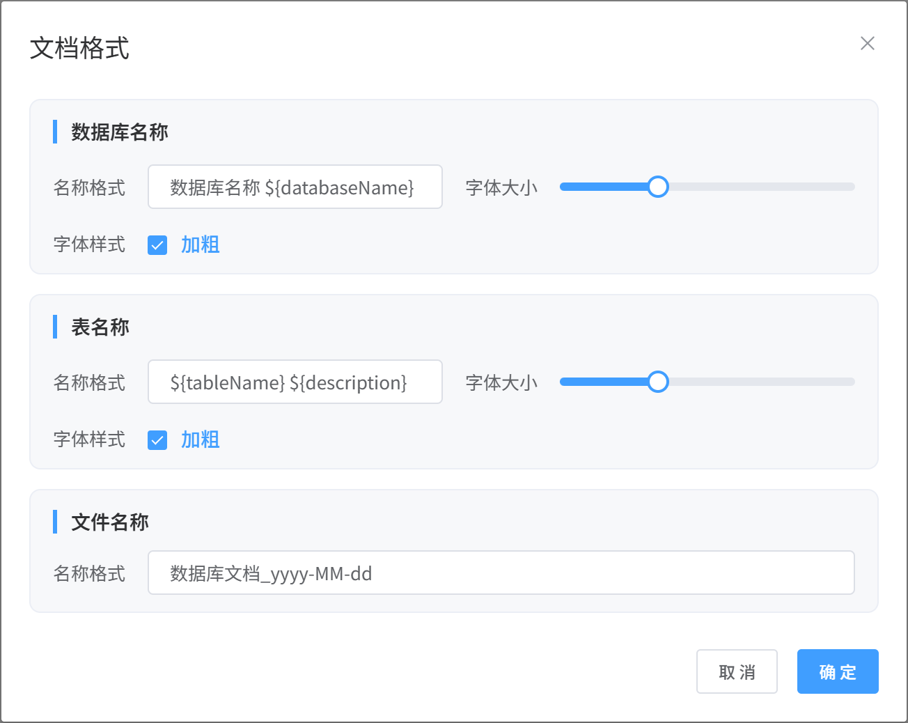
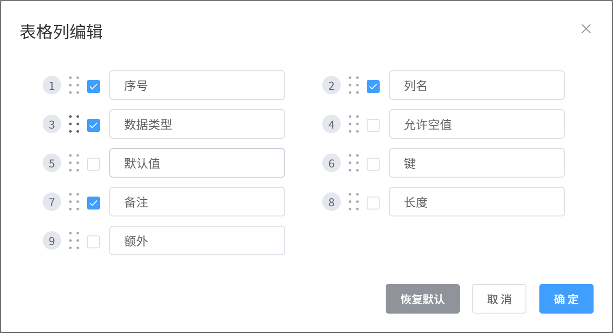
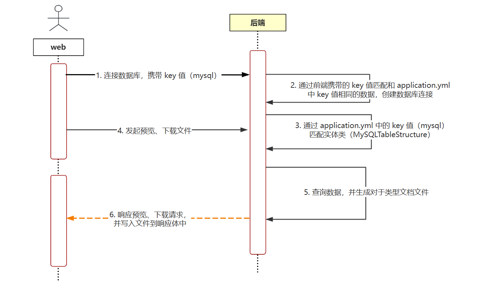

<h1 align="center" style="margin: 30px 0 30px; font-weight: bold;">DbSnap</h1>


## 简介

一个简单易用且高效的数据库表结构文档导出工具，让编写数据库表结构文档变得十分简单 ！！！
<br>

## 开发缘由

在工作中编写开发文档时，通常会涉及到数据库表结构这个部分。最开始使用各类文档编辑软件新建表格，然后逐个复制和粘贴内容，屏幕来回切换到头昏眼花，CV 操作到手抽筋，不注意还可能看错数据或填写表格时填错数据。之前也有尝试过编码 + 修改配置文件的方式，但是在更改数据库连接信息、导出哪些表及列信息时需要手动修改配置文件，使用起来并不是很方便。于是就萌生了开发该项目的想法，以简化数据库文档的编写。
<br>

## 技术栈

### 后端
- 核心框架：Spring Boot —— 提供便捷的配置与自动装配能力，快速构建稳健的微服务应用。
- 文档生成：
  - Apache POI —— 用于编写和生成 Word 文档
  - iTextPDF —— 用于编写和生成 PDF 文档

### 前端
- 核心框架：Vue 2 —— 轻量高效，提供响应式数据绑定与组件化开发模式。
- UI 组件库：Element UI —— 丰富的组件集合，助力快速搭建前端界面。
<br>

## 优势
- 灵活性高，可根据需求灵活选择导出的表列数据
- 扩展性良好，适配新型数据库，只需编写相关的配置与实体类，几乎不需要额外的业务逻辑编码
- 树形控件采用懒加载模式加载数据，避免数据量太大时，一次性加载全部数据，造成严重卡顿
- 多线程加载数据，提高数据量较大时的导出速度
- 文档导出格式灵活，文档输出格式可自定义
<br>

## 支持数据库类型
- MySQL
- Oracle
- PostgreSQL
- Sql Server
- DB2
- MariaDB
- Clickhouse
- 达梦
- TIDB
- Derby（内嵌式）
- H2（内嵌式）
- SQLite3（内嵌式）
<br>

## 支持文档类型
- Word
- PDF
- Markdown
- HTML
<br>

## 项目演示

**1. 创建数据库连接**

<br>
<br>

**2. 连接数据库**

<br>
<br>

**3. 文档格式**


- ① ${databaseName} 数据库名称
- ② ${tableName} 表名称
- ③ ${description} 表注释
- ④ yyyy-MM-dd 日期格式（例如：2024-01-01）

> 说明：上述标识符会在文件输出过程中替换为其对应的信息，可根据需求添加、更改上述标识符来实现是否显示标识符对应的信息及显示位置

<br>
<br>

**4. 文档预览**

<br>
<br>

**5. 表格列编辑**
  
<br>
<br>

**6. 下载pdf文档（示例）**


<br>
<br>

**7. 下载word文档（示例）**

  
<br>
<br>

**8. 下载markdown文档（示例）**

  
<br>
<br>

**9. 下载HTML文档（示例）**

  
<br>
<br>


## 自定义数据库类型
### 时序图

> 说明：以 MySQL 数据库为示例

<br>
<br>


### 编码

#### 1. 配置 JDBC 驱动依赖
以 MySQL 为例
```pom
      <dependency>
            <groupId>mysql</groupId>
            <artifactId>mysql-connector-java</artifactId>
            <version>8.0.22</version>
      </dependency>
```
<br>

#### 2. 配置数据源及查询 SQL 语句
在 `application.yml` 文件中配置数据源及相关 SQL 语句，以 MySQL 数据库为例：
```yaml
database:
  definitions:
    MySQL:
      driverClass: com.mysql.cj.jdbc.Driver
      url: jdbc:mysql://${host}:${port}/${database}?serverTimezone=Asia/Shanghai&useUnicode=true&characterEncoding=utf-8&useSSL=false&&allowPublicKeyRetrieval=true
      # 查询所有schemata
      databases: SELECT schema_name as labelName FROM information_schema.schemata

      # 查询指定schema下所有表
      tables: >
        select table_name as labelName, table_comment as description
        from information_schema.tables 
        where table_schema = #{0}

      # 查询指定schema下指定数据表字段信息
      tableStructure: >
        select column_name as columnName, data_type as columnType,
               column_comment as columnComment, is_nullable as isNullable,
               column_default as columnDefault, character_maximum_length as length,
               column_key as columnKey, extra as extra
        from information_schema.columns 
        where table_schema = #{0} and table_name = #{1}
        order by ordinal_position
```

**说明：**
- `url: jdbc:mysql://${host}:${port}/${database}` 中的 ${host}、${port}、${database} 为占位标识，分别表示  主机名称、数据库端口号、创建连接的数据库名称的具体值<br>
- #{0}、#{1} 为占位标识，分别表示 SQL 查询条件中数据库名称、表名称的具体值 
- 上述占位标识会在指定时期自动使用具体值进行替换，配置时直接将占位标识当作具体值使用即可
- <span style="color:red">特殊情况：某些查询 SQL 语句不支持起别名，请查看步骤五</sapn>

<br>

#### 3. 定义表结构实体类
在 entity 目录下创建 TableStructure 实现类，以 MySQL 为例：
```java
@Data
@Marker("MySQL")
public class MySQLTableStructure extends TableStructure {

    @TableField(value = "键类型", order = 6, exclude = true, enums = {"PRI->主键", "UNI->唯一键"})
    private String columnKey;

    @TableField(value = "长度", order = 7, exclude = true, enums = "null-> ")
    private Long length;

    @TableField(value = "额外", order = 8, exclude = true)
    private String extra;

}
```
**说明：**
- Marker 注解设置的值需与 application.yml 配置文件 database.definitions 下的数据库类型 key 对应的属性名匹配（对应步骤二中的 MySQL）。
- MySQLTableStructure 继承 TableStructure，TableStructure 默认包含了一些属性
- MySQLTableStructure 中定义的属性为各类数据库表结构特有字段，可自定义所需属性
- @TableField 中 value 表示表格标题，order 表示输出顺序，exclude 表示是否输出该列数据。enums 表示值映射，例如 0->NO 表示当属性的值为 0 时，将被替换为 NO 输出到表格中

TableStructure 类结构如下
```java

@Data
public abstract class TableStructure implements WordTableInterceptor, PDFTableInterceptor, MarkdownTableInterceptor, HTMLTableInterceptor {

    @TableField(value = "序号", order = 0)
    private Integer number;

    @TableField(value = "列名", order = 2)
    private String columnName;

    @TableField(value = "数据类型", order = 3)
    private String columnType;

    @TableField(value = "允许空值", order = 4, exclude = true, enums = {"Y->YES", "N->NO"})
    private String isNullable;

    @TableField(value = "默认值", order = 5, enums = "null->NULL", exclude = true)
    private String columnDefault;

    @TableField(value = "备注", order = 6, enums = "null-> ")
    private String columnComment;

    // 省略其他方法
}
```

<br>

#### 4. 编写数据库连接信息配置
在 database-config.json 文件下配置前端数据，示例如下
```json
[
  {
    "type": "MySQL",
    "developed": true,
    "icon": "/icon/svg/database/MySQL.svg",
    "properties": [
      { "key": "host", "label": "主机", "value": "127.0.0.1", "required": true },
      { "key": "port", "label": "端口", "value": 3306, "required": true },
      { "key": "database", "label": "数据库", "value": "mysql", "required": true },
      { "key": "username", "label": "用户名", "value": "", "required": false },
      { "key": "password", "label": "密码", "value": "", "required": false }
    ]
  }
]
```

**参数说明：**
- type 数据库类型， 值需与 application.yml 配置文件 database.definitions 下的数据库类型 key 对应的属性名匹配（对应步骤二中的 MySQL）。
- developed 是否开发完成，当设置为 false 时前端页面不显示该数据库，反之则显示
- icon 前端页面显示的数据库图标
- properties 连接数据库需要用户填写的内容
  - key 属性名
  - label 属性描述
  - value 属性值
  - required 是否必要，设置为 false 表示可选属性，前端不做非空校验；设置为 true 表示必须属性，前端做非空校验

<br>

#### 5. 编写数据库连接信息接收类
```java
@Marker(DatabaseTypes.MYSQL)
public class MySQLDataSourceProperties extends ServerDataSourceProperties {
  //@Override
  //public String buildUrl(String url) {
  //    return url.replace("${host}", this.host).replace("${port}", String.valueOf(this.port)).replace("${database}", this.database);
  //}
}
```
**说明**
- DataSourceProperties 实现类中定义的属性需与步骤四中 properties 中对象的 key 一一对应，确保反序列化时能够接受 properties 中定义的所有属性值
- Marker 注解设置的值需与 application.yml 配置文件 database.definitions 下的数据库类型 key 对应的属性名匹配（对应步骤二中的 MySQL）。
- MySQLDataSourceProperties 继承 ServerDataSourceProperties，ServerDataSourceProperties 默认包含了一些属性与构建数据源 url 的方法。
- MySQLDataSourceProperties 中定义的属性为各类数据库特有的连接信息字段，可自定义所需属性与重写 buildUrl 方法
- 当父类包含的默认属性与 buildUrl 无法正确构建数据源 url 时，需在子类新增属性与重写 buildUrl 方法自行构建并返回 url


<br>

#### 6. SQL不支持起别名情况
不能起别名的 sql 语句前添加 tag 标识（必须唯一）
```yml
/* [TAG:xxx] */ PRAGMA database_list
```


创建 ResultSetInterceptor 查询结果拦截器，自行处理结果封装，并将其注入 Spring 容器
```java
@Component
public class MySQLInterceptor implements ResultSetInterceptor<TableStructure> {
  /**
   * 是否执行查询结果拦截
   * @param metaData jdbc原生 DatabaseMetaData 对象
   * @param tag 结果特殊处理sql语句标识，即上述 sql 语句中设置的 tag 值 xxx
   * @return
   */
    @Override
    public boolean support(DatabaseMetaData metaData, String tag) {
        // 返回 true 拦截, false 不拦截
        return false;
    }

  /**
   * 拦截查询结果
   * @param resultSet jdbc原生查询结果集
   * @return
   * @throws Exception
   */
    @Override
    public List<TableStructure> intercept(ResultSet resultSet) throws Exception {
        // 自行封装结果并返回实体对象集合
        return null;
    }
}
```
<br>


## 使用说明

**默认访问地址：http://localhost:8888/**
> 项目启成功后自动打开浏览器进行访问

<br>

## Docker安装
<br>

## windows下载
```shell
百度网盘链接：https://pan.baidu.com/s/175okyv8fiVAQBOB_q2jKjg?pwd=w7rq
```
<br>


## 联系作者
<br>


## 赞赏

<br>
<br>

## 常见问题
**① DbSnap.exe 启动失败，可能原因**

- 端口冲突：DbSnap.exe 所在目录下创建文件 DbSnap.exe.vmoptions, 添加如下配置并更改端口号
  ```shell
  -Dserver.port=8888
  ```
- 默认使用 win64 位操作系统环境，不兼容 win32 位操作系统环境（后续考虑兼容）
<br>
<br>


## 更新日志

**2025-03-03**
- 新增自定义列名输出顺序

<br>

**2025-02-23**
- 新增自定义表头名称功能与持久化
- 优化数据库结果拦截器匹配规则
- 修复表备注信息为 null 时，空指针异常问题

<br>

**2025-01-25**
- 重构页面，修复拖拽条还是会偶尔断触问题
- 更改 svg 图片引入方式
- 新增数据加载提示动画

<br>


**2024-11-08**
- 新增自定义导出文档数据库名称、表名称输出结构、样式以及输出文件名称
- 新增自定义输出格式持久化

<br>

**2024-08-26**
- 修复 sqlserver 查询表结构数据部分信息对不上

<br>

**2024-05-08**
- 修复 jar 在中文路径下运行，扫描不到包，出现空指针异常
- 新增内嵌式数据库 SQLite3 数据库
- 新增内嵌式数据库 H2 数据库
- 新增内嵌式数据库 Derby 数据库
- 新增数据库 TIDB

<br>

**2024-04-20**
- 左侧菜单栏添加库图标和表图标
- 新增结果拦截器功能，用于处理无法取别名导致数据库与实体类无法正确映射
- 优化拖拽条拖拽手感

<br>

**2024-04-16**
- 新增达梦数据库
- 页面左侧树状数据库结构数据由一次性全部加载更改为点击时懒加载

<br>

**2024-04-09**
- 新增 clickhouse 数据库
- 新增 sqlServer 数据库

<br>

**2024-03-14**
- 新增 Html 文档导出功能
- 将 word、pdf、markdown 文档相关功能提取为 document4j 项目中，通过外部方式引入

<br>

**2024-03-01**
- 新增 PostgreSQL 数据库
- 解决 window 环境下控制台中文乱码
- 新增项目启动自动打开浏览器访问项目功能
- 修复 MySQL 5.7 Bigint 类型映射到 Long 类型转换异常

<br>

**2024-01-31**
- 新增 markdown 文档功能
- 更改 PDF 生成方式，由最初使用第三方库转 word 文档为 pdf 文档(不仅耗时，部分样式还会丢失)，改为通过使用 pdf 库将数据写入 pdf 文档方式

<br>

**2023-12-25**
- 修复对话框弹出，页面出现滚动条，从而发生抖动

<br>

**2023-12-10**
- 版本 1.0 升级为 2.0 初始版本，前后端架构重构，逐步开始优化性能与提高扩展性

<br>