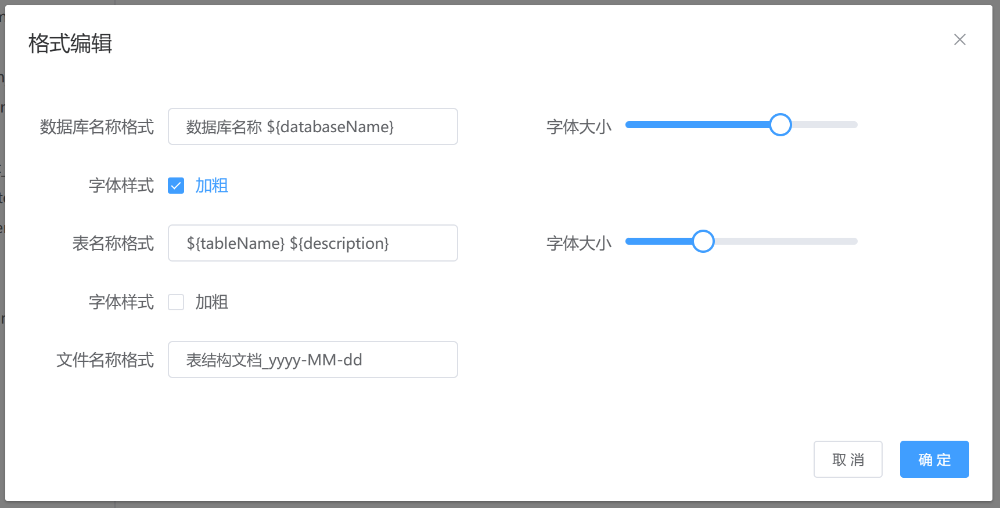

<h1 align="center" style="margin: 30px 0 30px; font-weight: bold;">TableStructureGenerator</h1>


## 简介

一个简单易用且高效的数据库表结构文档生成工具，让编写数据库表结构文档变得简单
<br>

## 开发缘由

在工作中编写开发文档时，通常会涉及到数据库表结构这个部分。最开始使用各类文档编辑软件新建表格，然后逐个复制和粘贴内容，屏幕来回切换到头昏眼花，CV操作到手抽筋，不注意还可能看错数据或填写表格时填错数据。之前也有尝试过编码+修改配置文件的方式，但是在更改数据库连接信息、导出哪些表及列信息时需要手动修改配置文件，使用起来并不是很方便。于是就萌生了开发该项目的想法，以简化数据库文档的编写。
<br>
<br>

## 技术栈

### 后端

- 采用 SpringBoot 作为基础框架
- 采用 apache poi 生成word文档
- 采用 itextpdf 生成pdf文档
- 采用 snakeyaml 解析yaml文件

### 前端

- 采用 Vue2 作为基础框架
- 采用 Element ui 作为组件库
  <br>
  <br>

## 优势

- 灵活性高，可根据需求灵活选择导出的表列数据
- 扩展性良好，适配新的数据库类型，只需提供对应的查询SQL语句，几乎不需要额外的编码
- 树形控件采用懒加载模式加载数据，避免数据量太大时，一次性加载全部数据，造成严重卡顿
- 多线程加载数据，提高数据量较大时的导出速度

<br>

## 支持数据库类型

- MySQL
- Oracle
- PostgreSQL
- Sql Server
- DB2
- MariaDB
- Clickhouse
- 达梦
- TIDB
- Derby（内嵌式）
- H2（内嵌式）
- SQLite3（内嵌式）

<br>

## 支持文档类型

- Word
- PDF
- Markdown
- HTML

<br>

## 项目演示

**1. 创建数据库连接**

<br>
<br>

**2. 连接数据库**

<br>
<br>

**3. 格式编辑**


- ① ${databaseName} 数据库名称
- ② ${tableName} 表名称
- ③ ${description} 表注释
- ④ yyyy-MM-dd 日期格式（例如：2024.01.01）

> 说明：上述标识符会在文件输出过程中替换为其对应的信息，可根据需求添加、更改上述标识符来实现是否显示标识符对应的信息及显示位置

<br>
<br>

**4. 文档预览**

<br>
<br>

**5. 选择导出列名**
  
<br>
<br>

**6. 下载pdf文档（示例）**


<br>
<br>

**7. 下载word文档（示例）**

  
<br>
<br>

**8. 下载markdown文档（示例）**

  
<br>
<br>

**9. 下载HTML文档（示例）**

  
<br>
<br>

## windows下载

```shell
链接：https://pan.baidu.com/s/1PKHjclAsCJ5PnsV7JHRloA 
提取码：w3xc
```

<br>
<br>

## 自定义数据库类型

### 1. 配置数据源及查询SQL语句
在 `application.yml` 文件中配置数据源及相关SQL语句，如下以 MySQL 数据库为例
```yaml
database:
  info:
    # 作为定义 TableStructure 类的前缀（最好直接设置为数据库类型），mysql数据库定义为 MySQLTableStructure（步骤三类命名使用）
    mysql:
      driverClass: com.mysql.cj.jdbc.Driver
      url: jdbc:mysql://${ip}:${port}/${database}?serverTimezone=Asia/Shanghai&useUnicode=true&characterEncoding=utf-8&useSSL=false&&allowPublicKeyRetrieval=true

      # 查询所有数据库名称
      databases: >
        SELECT schema_name as labelName FROM information_schema.schemata

      # 查询指定数据库下所有的表名称及表注释
      tables: >
        select table_name as labelName, table_comment as description
        from information_schema.tables 
        where table_schema = #{0}

      # 查询指定指定数据库下指定的表字段信息
      tableStructure: >
        select column_name as columnName, data_type as columnType,
               column_comment as columnComment, is_nullable as isNullable,
               column_default as columnDefault, character_maximum_length as length,
               column_key as columnKey, extra as extra
        from information_schema.columns 
        where table_schema = #{0} and table_name = #{1}
        order by ordinal_position
```

> 说明：<br>
> ① `url: jdbc:mysql://${ip}:${port}/${database}`中的 ${ip}、${port}、${database} 为占位标识，分别表示 ip
> 地址、数据库端口号、创建连接的数据库名称的具体值<br>
> ② #{0}、#{1} 为占位标识，分别表示SQL查询条件中数据库名称、表名称的具体值<br>
> ③ 上述占位标识会在指定时期自动使用具体值进行替换，配置时直接将占位标识当作具体值使用即可<br>
> ④ 上述SQL查询条件中的别名不能随意定义，需要与对应的 TableStructure 类中的属性名一致

<br>

### 2. 定义表结构实体类
在 entity目录下创建 TableStructure 类，以 MySQL 为例
```java

@Data
public class MySQLTableStructure extends TableStructure {

    @TableField(value = "键类型", order = 6, exclude = true, enums = {"PRI->主键", "UNI->唯一键"})
    private String columnKey;

    @TableField(value = "长度", order = 7, exclude = true, enums = "null-> ")
    private Long length;

    @TableField(value = "额外", order = 8, exclude = true)
    private String extra;

}
```

> 说明：<br>
> ① 自定义 TableStructure 命名格式必须为 xxxTableStructure，其中 xxx 需与步骤一中 key 的命名相对应。例如 MySQL 命名为
> MySQLTableStructure 其中的 MySQL 前缀对应步骤一的 mysql<br>
> ② MySQLTableStructure 继承 TableStructure，TableStructure 默认包含了一些属性<br>
> ③ MySQLTableStructure 中定义的属性为各类数据库表结构特有字段，可自定义所需属性<br>
> ④ @TableField 中 value 表示表格标题，order 表示输出顺序，exclude 表示是否输出该列数据。enums 表示值映射，例如 0->NO 表示当属性的值为
> 0 时，将被替换为 NO 输出到表格中

TableStructure 类结构如下
```java

@Data
public abstract class TableStructure implements WordTableInterceptor, PDFTableInterceptor, MarkdownTableInterceptor, HTMLTableInterceptor {

    @TableField(value = "序号", order = 0)
    private Integer number;

    @TableField(value = "列名", order = 2)
    private String columnName;

    @TableField(value = "数据类型", order = 3)
    private String columnType;

    @TableField(value = "允许空值", order = 4, exclude = true, enums = {"Y->YES", "N->NO"})
    private String isNullable;

    @TableField(value = "默认值", order = 5, enums = "null->NULL", exclude = true)
    private String columnDefault;

    @TableField(value = "备注", order = 6, enums = "null-> ")
    private String columnComment;

    // 省略其他方法
}
```

<br>

### 3. 配置前端数据
在 database-config.json 文件下配置前端数据，示例如下
```json
[
  //非内嵌式数据库
  {
    "developed": true,
    "embedded": false,
    "defaultPort": 3306,
    "label": "MySQL",
    "value": "mysql",
    "icon": ""
  },
  //内嵌式数据库
  {
    "developed": true,
    "embedded": true,
    "label": "SQLite3",
    "value": "sqlite3",
    "ipVisible": false,
    "portVisible": false,
    "usernameVisible": false,
    "passwordVisible": false,
    "icon": ""
  }
]
```

**参数说明：**
- developed 是否开发完成，false 时前端显示该数据库
- embedded 是否是内嵌式数据库
- defaultPort 默认端口
- label 数据库名称
- value 匹配 application.yml 文件中数据源及 SQL 语句的 key（一般设置为数据库名称）
- icon 数据库图标，值为 svg 编码
- ipVisible 隐藏IP地址项，部分内嵌式数据库通过文件地址读取数据
- portVisible: 隐藏端口项，部分内嵌式数据库通过文件地址读取数据
- usernameVisible: 隐藏用户名项
- passwordVisible: 隐藏密码项

<br>

## 使用说明

**默认访问地址：http://localhost:8888/**
> 项目启成功后自动打开浏览器进行访问

<br>
<br>

## Docker安装

<br>
<br>

## 赞赏


<br>
<br>

## 常见问题

**① tableStructureGenerator.exe 启动失败，可能原因**

- 端口冲突：tableStructureGenerator.exe 所在目录下创建文件 tableStructureGenerator.exe.vmoptions, 添加如下配置并更改端口号
  ```shell
  -Dserver.port=8888
  ```
- 默认使用 win64 位操作系统环境，不兼容 win32 位操作系统环境（后续考虑兼容）

## 参考说明

数据库连接页面布局参考至：https://gitee.com/pomz/database-export